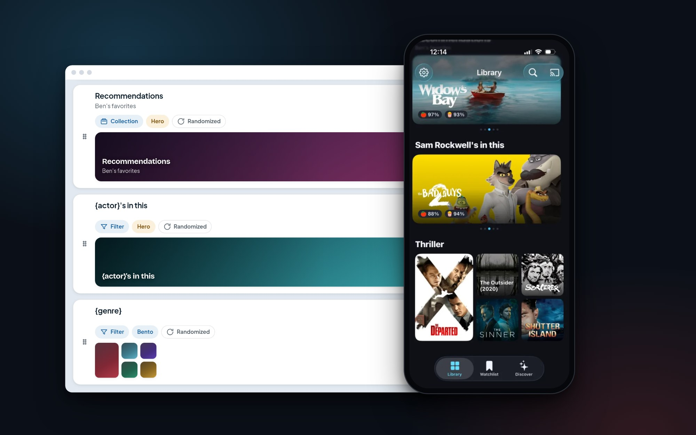
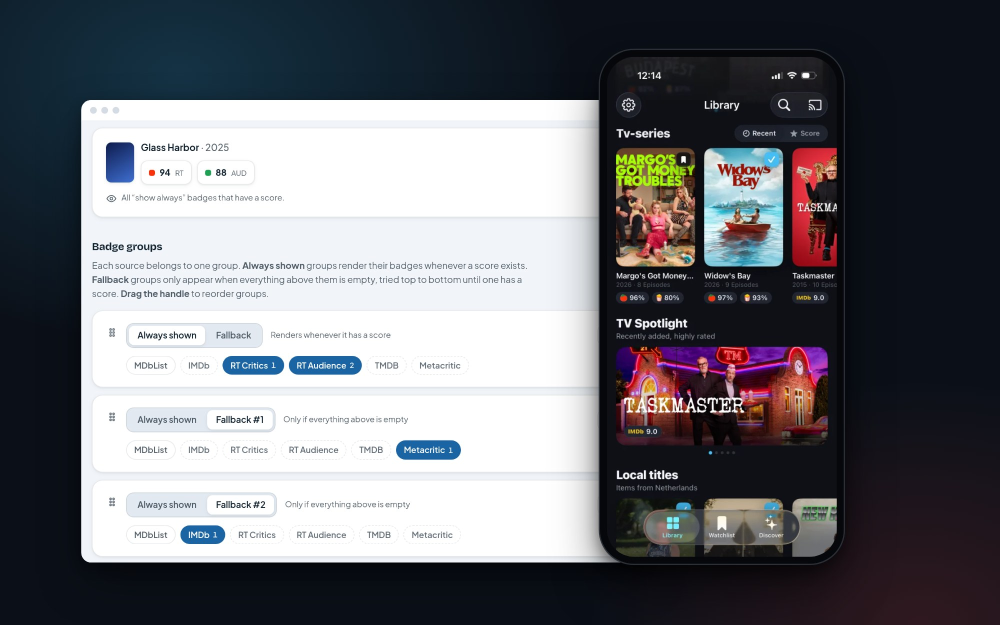
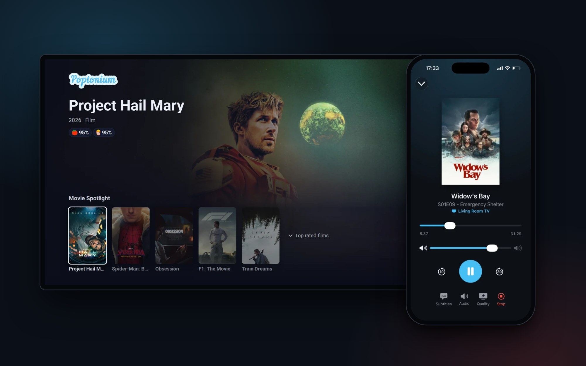

<p align="center">
  
</p>

<p align="center">
  <b>Shape the Plex app everyone on your server sees.</b><br>
  The self-hosted companion server for <a href="https://poptonium.app">Poptonium</a>, a Plex client for
  <a href="https://apps.apple.com/nl/app/poptonium-for-plex/id6779742766?l=en-GB">iOS</a> and
  <a href="https://play.google.com/store/apps/details?id=games.benja.poptonium">Android</a>.
</p>

<p align="center">
  
  <br><sub>Build rows and heroes in the admin. They appear on everyone's Library page.</sub>
</p>

<p align="center">
  
  <br><sub>Pick which scores show, with fallbacks when a title has none.</sub>
</p>

<p align="center">
  
  <br><sub>Poptonium's own Cast receiver, with a Spotlight of your library while nothing plays.</sub>
</p>

## Poptonium

**Always, with or without the server**

- **Google Cast done properly.** Poptonium has its own receiver: styled ASS/SSA subtitles are never burned in, and switching subtitles doesn't restart the video. Controls live in a Live Activity on iPhone and a media notification on Android.
- **Plays almost anything.** An mpv-based player on iPhone direct-plays nearly every container and codec. Android transcodes only when the device can't decode.

**With this server**

- **Your library, laid out your way.** Rows, heroes and bento grids from Plex collections or filters. No streaming, Discover or live TV shelves.
- **Ratings you choose.** IMDb, Rotten Tomatoes, TMDB and Metacritic, with your own display and weighting (via MDbList).
- **Subtitles without accounts.** Viewers search and download in-app through your OpenSubtitles connection.
- **Discover and requests.** A nightly popular feed, with requests routed to your Overseerr.
- **TV Spotlight.** The Cast receiver shows your sections while nothing plays.
- **Share links** with rich previews.

Feature details and guides: **[poptonium.app](https://poptonium.app)**.

## Install

| | |
|---|---|
| Image | `ghcr.io/benjafin/poptonium:latest` (stable), `:dev` (develop) |
| Port | container `8085`, published on host port **`3654`** |
| Volumes | `/data` for config, DB and caches. Optionally your media, read-only ([below](#media-mount)) |

**Unraid**: install **Poptonium** from Community Applications.

**Docker**:

```bash
docker run -d --name poptonium --restart unless-stopped \
  -p 3654:8085 \
  -v /path/to/appdata/poptonium:/data \
  ghcr.io/benjafin/poptonium:latest
```

**Compose**: the included [`docker-compose.yml`](docker-compose.yml) builds from source.

> [!IMPORTANT]
> Publish on host port **3654**, ideally on the same host as Plex. Without a proxy, the app probes `http://<plex-host>:3654`.

## Configure

Open `http://<host>:3654/admin`, create the admin account, and run the setup wizard. It tests every connection before saving:

| Integration | Enables | Credentials |
|---|---|---|
| **Plex** (required) | Everything | Server URL (e.g. `http://plex:32400`) and token |
| MDbList | Ratings, popular feed | API key |
| Overseerr | Requests | URL and API key |
| OpenSubtitles | Subtitle search and download | Consumer API key and an account (20 downloads/day free) |

Every optional integration can be left out, which disables only its feature. The wizard then offers starter sections based on your libraries.

## Reverse proxy

The proxy is what makes the server reachable outside your LAN and from the Cast receiver. Set it up after the server is running.

### How the app finds the server

There is no address to enter in the app. It reads the connections plex.tv advertises for your Plex server and probes two candidates for each one, LAN connections first:

1. `<connection>/poptonium/capabilities` (reverse proxy)
2. `http://<connection host>:3654/capabilities` (direct)

The highest-priority candidate that answers wins. This means:

- **LAN, no proxy**: works through (2) when Poptonium is published on port 3654 of the Plex host.
- **Remote**: needs (1). Your proxied URL must be one of the connections Plex advertises.
- **Cast receiver**: it runs on `https://poptonium.app/cast/`, so it can only reach an **https** backend. Spotlight and fast Cast subtitles need the https proxy, even on your LAN.

### Steps

1. **Advertise the proxied Plex URL.** In Plex, go to *Settings > Network > Custom server access URLs* and add your proxied domain, e.g. `https://plex.example.com:443`. Skip this if it's already listed.
2. **Proxy `/poptonium/` to the container**, without a path rewrite. The server serves every route under both `/` and `/poptonium`.
3. **Keep `/poptonium/admin` LAN-only.** The app never calls it, and the admin stays reachable directly on `:3654`.
4. **If you geo-block or LAN-restrict the domain**, exempt `/poptonium/s/`. Share pages are public, and link-preview crawlers need to reach them.
5. **Verify** from outside your LAN:

   ```bash
   # expect {"service":"poptonium",...}
   curl -s https://plex.example.com/poptonium/capabilities
   # expect 403 (404 with SWAG)
   curl -sI https://plex.example.com/poptonium/admin
   ```

Then sign out and back in to the app, or relaunch it, so discovery runs again.

### nginx

Add these blocks inside the `server { }` of your existing Plex proxy. The regex location is matched before the prefix location, and both win over Plex's `location /`.

```nginx
location ~ ^/poptonium/admin(/|$) {
    allow 10.0.0.0/8;
    allow 172.16.0.0/12;
    allow 192.168.0.0/16;
    deny all;
    proxy_pass http://poptonium:8085;    # no URI part: path is preserved
}

location /poptonium/ {
    proxy_pass http://poptonium:8085;
    proxy_set_header Host $host;
    proxy_set_header X-Forwarded-For $proxy_add_x_forwarded_for;
    proxy_set_header X-Forwarded-Proto $scheme;
}
```

Use `poptonium:8085` when the proxy shares a Docker network with the container, and `<host-ip>:3654` otherwise.

**SWAG**: use [`swag/poptonium.subdomain.conf`](swag/poptonium.subdomain.conf). It restricts the admin with SWAG's `$lan-ip` and includes `proxy.conf`/`resolver.conf`.

**Caddy, Traefik and others**: the requirements are the same. Forward `/poptonium/*` unchanged, restrict `/poptonium/admin*` to private ranges (`remote_ip private_ranges` in Caddy, an `ipAllowList` middleware in Traefik), and keep the Plex route as the catch-all.

## Optional

### Share links

Set *Integrations > Share links* to the public base URL, e.g. `https://plex.example.com/poptonium`. Leaving it blank keeps sharing off, and the app hides its Share button.

### Media mount

Mount your media read-only **at the same container paths Plex uses**:

```bash
-v /mnt/user/media/Movies:/movies:ro -v "/mnt/user/media/TV Shows:/tv:ro"
```

The server then extracts embedded subtitle tracks for the Cast receiver straight from the file (ffmpeg is bundled). They arrive in under a second, with ASS styling kept. The mount also enables **phone audio while casting**: the TV plays muted, and the app streams a synced Opus track from `/cast/audio`.

If the paths can't match, map them with `SUBTITLE_PATH_MAP=/plex/path=/container/path;...`. The dashboard's *Cast subtitles* tile shows which Plex library folders are visible. Without the mount, subtitles go through Plex.

### Environment variables

Configuration lives in `/data/config.json` and is managed in the admin. These variables only seed it on first start, which is useful for scripted deploys:

| Variable | |
|---|---|
| `PLEX_URL`, `PLEX_TOKEN` | Plex |
| `MDBLIST_API_KEY` | MDbList |
| `OVERSEERR_URL`, `OVERSEERR_API_KEY` | Overseerr |
| `OPENSUBTITLES_API_KEY`, `OPENSUBTITLES_USERNAME`, `OPENSUBTITLES_PASSWORD` | OpenSubtitles |
| `PUBLIC_URL` | Share links base URL |
| `SUBTITLE_PATH_MAP` | Media path mapping (read on every start) |
| `TZ` | Timezone for the nightly jobs |

## License

[MIT](LICENSE)
