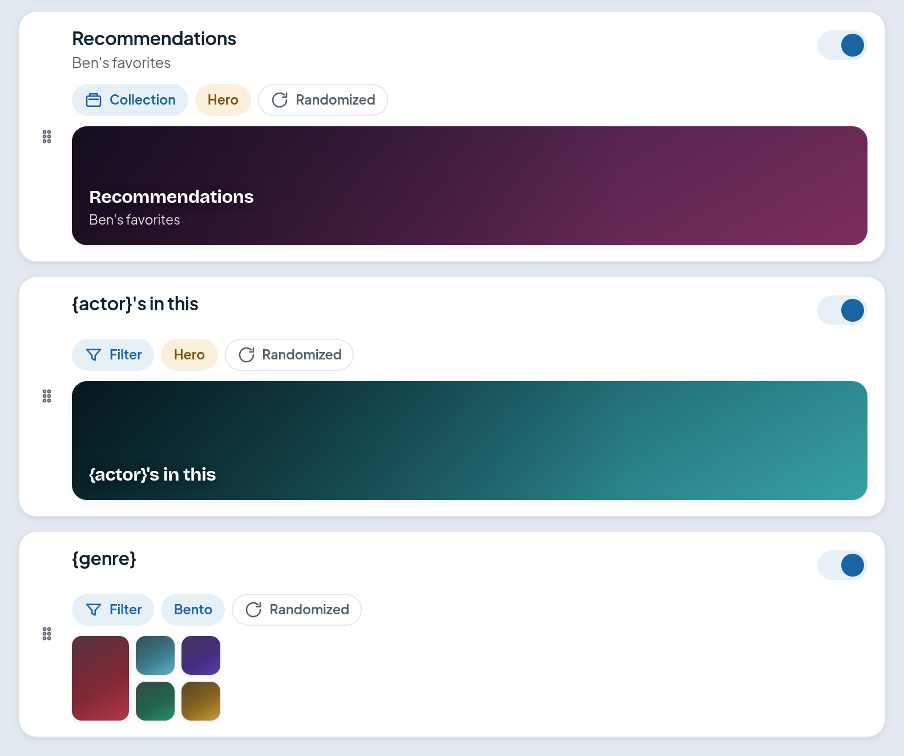
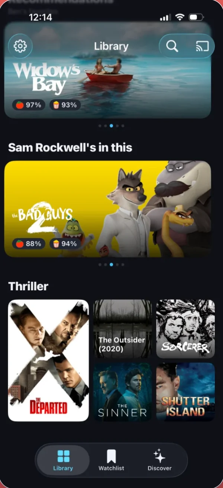
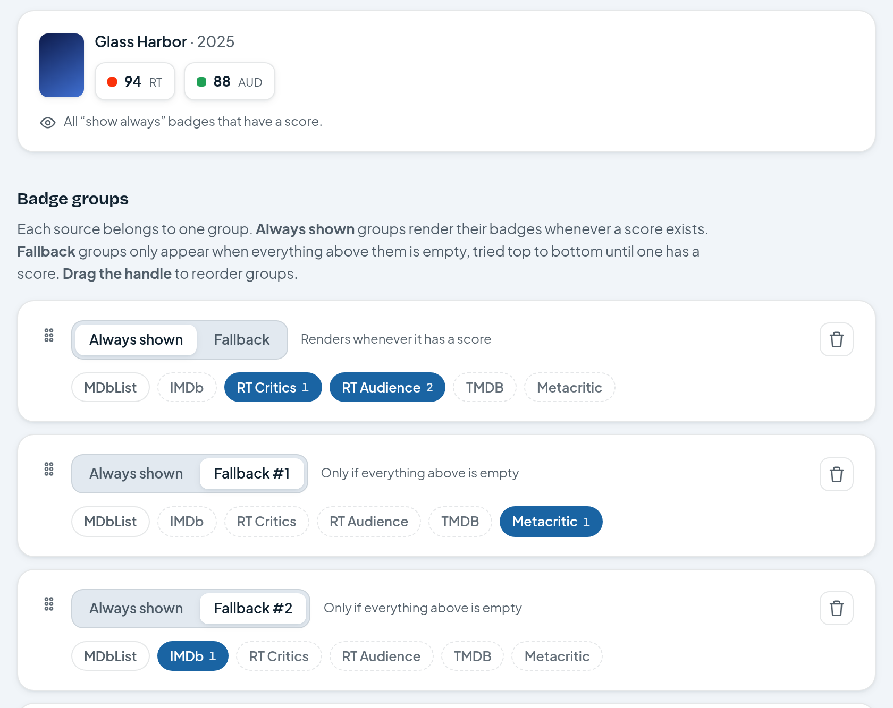
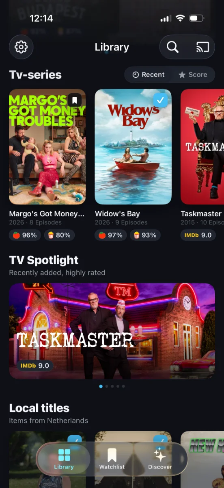
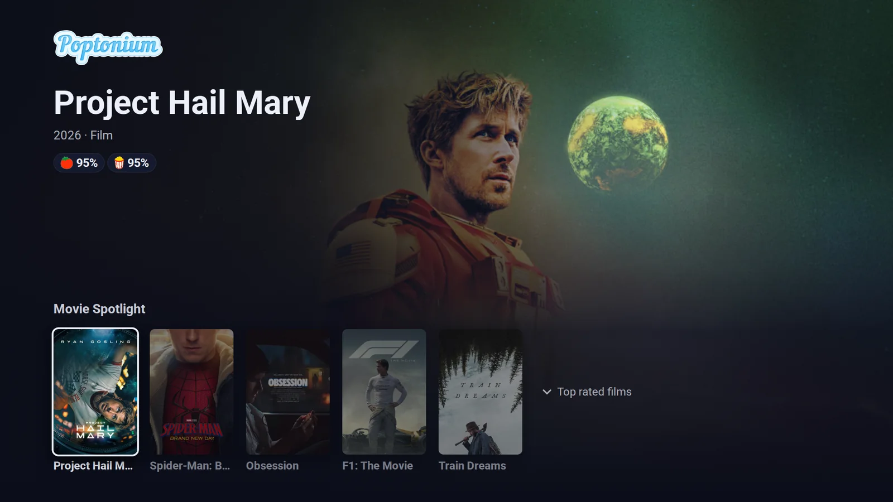

<p align="center">
  
</p>

<p align="center">
  <b>The companion server for <a href="https://poptonium.app">Poptonium</a>, the Plex client you curate.</b><br>
  <a href="https://apps.apple.com/nl/app/poptonium-for-plex/id6779742766?l=en-GB">iOS</a> ·
  <a href="https://play.google.com/store/apps/details?id=games.benja.poptonium">Android</a> ·
  <a href="https://poptonium.app">poptonium.app</a>
</p>

<table>
  <tr>
    <td></td>
    <td></td>
  </tr>
  <tr>
    <td colspan="2" align="center"><sub>Build rows and heroes in the admin. They appear on everyone's Library page.</sub></td>
  </tr>
  <tr>
    <td></td>
    <td></td>
  </tr>
  <tr>
    <td colspan="2" align="center"><sub>Pick which scores show, with fallbacks when a title has none.</sub></td>
  </tr>
  <tr>
    <td colspan="2"></td>
  </tr>
  <tr>
    <td colspan="2" align="center"><sub>The same sections drive the TV while nothing is playing.</sub></td>
  </tr>
</table>

## What it adds

- **Curated library**: sections from Plex collections or rating, date and genre filters
- **Ratings**: IMDb, Rotten Tomatoes, TMDB and Metacritic
- **Subtitles**: in-app search and download, styled subtitles when casting
- **Popular feed**, **requests** via Overseerr, and **share links**

Without the server, Poptonium is a regular Plex client. More on [poptonium.app](https://poptonium.app).

## Install

**Unraid**: search **Poptonium** in Apps.

**Docker**:

```bash
docker run -d --name poptonium --restart unless-stopped \
  -p 8085:8085 \
  -v /path/to/appdata:/data \
  ghcr.io/benjafin/poptonium:latest
```

Keep the host port at **8085**: on your LAN, the app looks for the server there on the Plex host.

## Set up

Open `http://<host>:8085/admin`, create an account, and follow the wizard.

| Integration | Enables | Needs |
|---|---|---|
| **Plex** | Required | URL and token |
| MDbList | Ratings, popular feed | API key |
| Overseerr | Requests | URL and API key |
| OpenSubtitles | Subtitles | API key and account |

Skip any optional one to turn that feature off.

## Optional

### Remote access

Add two rules to your existing Plex reverse proxy:

1. Proxy `/poptonium/` to `poptonium:8085`, keeping the path.
2. Limit `/poptonium/admin` to your LAN.

For SWAG, paste [`swag/poptonium.subdomain.conf`](swag/poptonium.subdomain.conf) into your Plex conf.

### Share links

Set **Integrations > Share links** to your public URL, e.g. `https://plex.example.com/poptonium`. If your proxy blocks outside traffic, allow `/poptonium/s/`.

### Media mount (casting)

Mount your media read-only at the **same paths Plex uses**:

```bash
-v /mnt/media/Movies:/movies:ro
```

This enables instant, styled subtitles and phone audio while casting. If the paths differ, set `SUBTITLE_PATH_MAP=/plex/path=/container/path;...`.

### Environment variables

These pre-fill the wizard on first start:

`PLEX_URL` `PLEX_TOKEN` `MDBLIST_API_KEY` `OVERSEERR_URL` `OVERSEERR_API_KEY` `OPENSUBTITLES_API_KEY` `OPENSUBTITLES_USERNAME` `OPENSUBTITLES_PASSWORD` `PUBLIC_URL` `SUBTITLE_PATH_MAP` `TZ`

## License

[MIT](LICENSE)
